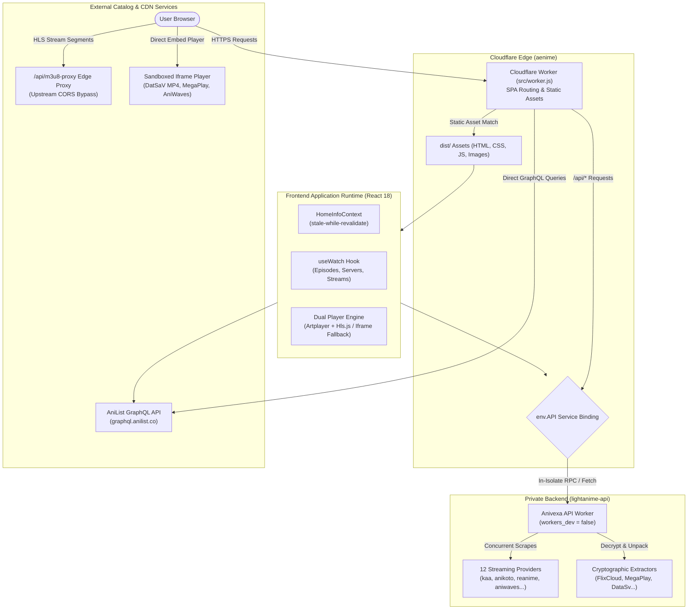

<p align="center">
  <div align="center">
    <a href="https://aenime.qzz.io">
      
    </a>
  </div>
  <h3 align="center">Aenime - Ad-Free Anime Streaming Platform</h3>
  <p align="center">
    <a href="https://github.com/aenime-project/aenime">
      
    </a>
    <a href="https://github.com/aenime-project/aenime/issues">
      
    </a>
    <a href="https://github.com/aenime-project/aenime">
      
    </a>
  </p>
  <p align="center">
    <a href="https://react.dev/"></a>
    <a href="https://vitejs.dev/"></a>
    <a href="https://tailwindcss.com/"></a>
    <a href="https://workers.cloudflare.com/"></a>
    <a href="https://artplayer.org/"></a>
  </p>
</p>

<p align="center">
  <a href="https://aenime.qzz.io">Aenime</a> is an open-source anime streaming platform powered by a <a href="https://github.com/carlodandan/lightanime-api">custom multi-provider API</a> (thanks to <a href="https://github.com/itzzzme/aesthetic-anime-api">itzzzme</a> &amp; <a href="https://github.com/walterwhite-69/Anivexa-API">walterwhite-69</a>), built using React 18, JavaScript, and Tailwind CSS, and deployed directly on Cloudflare Workers (SPA assets mode). It lets you easily discover any anime with intuitive search, autocomplete suggestions, top searches, and stream high-definition episodes across multiple providers without ads.
</p>

<p align="center">
  <a href="https://aenime.qzz.io">Live Demo</a> •
  <a href="#system-architecture">Architecture</a> •
  <a href="#key-features">Features</a> •
  <a href="#getting-started">Getting Started</a> •
  <a href="#deployment--cloudflare-workers">Deployment</a>
</p>

<p align="center">
   <div align="center">
    <a href="https://aenime.qzz.io/">
      
    </a>
  </div>
 </p>

---

## Overview

**Aenime** is a next-generation Single-Page Application (SPA) built with React 18, Vite, and Tailwind CSS. It delivers a fast, responsive interface for browsing anime catalogs, exploring detailed franchise metadata, and streaming episodes across multiple providers.

The frontend is served from Cloudflare Workers edge nodes (`assets` binding) and communicates with the backend aggregator ([`lightanime-api`](https://github.com/carlodandan/lightanime-api)) via **Cloudflare Service Bindings**—ensuring private, sub-millisecond edge communication with zero public API exposure.

---

## System Architecture



---

## Key Features

### 1. Catalog & Discovery Engine (AniList GraphQL)
- **Direct Catalog Integration**: Powers home spotlights, trending series, seasonal completions, upcoming releases, and alphabetical directories via AniList GraphQL (`https://graphql.anilist.co`).
- **Universal AniList Identity**: All titles are indexed by standard numeric AniList IDs (`/info/:id`, `/watch/:id`), with automatic fuzzy resolution for legacy text slugs.
- **Rich Media & Metadata**: High-resolution posters, widescreen banners, Japanese & English titles, genres, character lists, voice actor filmographies, franchise relations, and release schedules.
- **Stale-While-Revalidate Caching**: Home dashboard payloads are persisted in `localStorage` with a 2-hour TTL for instant cold boots while silently refreshing in the background.

### 2. Multi-Provider Streaming & Server Selection
- **Aggregated Provider Sources**: Consumes stream data from 12 distinct providers (`kaa`, `anikoto`, `reanime`, `aniwaves`, `anizone`, `senshi`, `animegg`, `animenosub`, `mkissa`, `animedunya`, `animeonsen`, `anipm`).
- **Dynamic Server Tabs**: Automatically categorizes available streams into **SUB**, **DUB**, and **RAW** servers per episode.
- **Detailed Episode Grid**: Flexible episode navigation supporting dual UI modes:
  - *Grid Mode*: Compact numbered buttons in chunks of 100 with search filtering for long-running series (e.g. *One Piece*).
  - *Detailed Mode*: Rich cards displaying AniZip thumbnails, runtimes, and filler episode flags.

### 3. Dual-Engine Video Player
- **Native Artplayer + HLS.js Engine**:
  - Adaptive HLS bitrate/quality switching (`1080p`, `720p`, `480p`, `360p`).
  - Chapter markers on the scrubber bar with automatic Intro and Outro skipping.
  - VTT thumbnail scrubber previews on hover.
  - Multi-language WebVTT subtitle switching and custom `.vtt` file upload support.
  - Autoplay, Auto-Next Episode, and Auto-Skip Intro preference persistence.
- **Sandboxed Iframe Fallback**:
  - Handles external embed servers (DatSaV MP4, MegaPlay, VidWish, AniWaves) using sandboxed iframes.
  - Supports `srcDoc` rendering with `<meta name="referrer" content="no-referrer">` for direct CORS-restricted MP4 streams.
- **Edge M3U8 Proxy**:
  - Built-in `/api/m3u8-proxy` proxy route to resolve upstream CORS and Referer restrictions on `.m3u8` playlists and `.ts` media segments.

### 4. Cloudflare Service Bindings (Zero Public API Exposure)
- The frontend Cloudflare Worker acts as the exclusive gateway to the backend API.
- All `/api/*` endpoints are forwarded internally via Cloudflare Service Bindings (`env.API.fetch()`).
- The backend `lightanime-api` has `workers_dev = false`, blocking direct public access and preventing external scraping.

---

## Project Structure

```text
aenime/
├── public/                     # Static root assets (favicon, robots.txt, sitemap.xml)
├── images/                     # Graphic assets and backgrounds
├── dist/                       # Production build output (generated by vite build)
├── src/
│   ├── config/                 # Website and branding configuration
│   ├── context/                # React context providers
│   │   ├── HomeInfoContext.jsx # Home dashboard data cache & revalidation
│   │   ├── LanguageContext.jsx # English vs Japanese title display state
│   │   └── SearchContext.jsx   # Search query & suggestion state
│   ├── hooks/                  # Custom React business logic hooks
│   │   ├── useWatch.js         # Streaming coordinator (details, episodes, servers, streams)
│   │   ├── useWatchControl.js  # Autoplay, auto-skip, and auto-next preferences
│   │   ├── useSearch.js        # Debounced search query hook
│   │   └── useToolTipPosition.js # Floating Qtip hover calculation
│   ├── pages/                  # Top-level view routes
│   │   ├── Home/               # Discovery dashboard (Spotlight, Trending, Top 10, Schedule)
│   │   ├── watch/              # Video playback interface (Player, Episode List, Servers)
│   │   ├── animeInfo/          # Anime metadata, voice actors, relations, recommendations
│   │   ├── search/             # Search results grid with pagination
│   │   ├── category/           # Genre and category filtering (top-airing, movie, tv, etc.)
│   │   ├── a2z/                # Alphabetical A-Z catalog index
│   │   └── donate/             # Community support page
│   ├── components/             # Reusable UI components
│   │   ├── banner/             # Spotlight hero banner with widescreen image rendering
│   │   ├── spotlight/          # Spotlight touch-enabled Swiper carousel
│   │   ├── trending/           # Horizontal trending carousel
│   │   ├── continue/           # Continue watching history carousel
│   │   ├── episodelist/        # Searchable episode list with range grouping
│   │   ├── servers/            # Audio & provider server switch tabs
│   │   ├── player/             # Artplayer wrapper, plugins, and iframe fallback
│   │   ├── qtip/               # Hover quick-preview card
│   │   ├── schedule/           # Airing broadcast schedule timetable
│   │   ├── navbar/             # Navigation header, search bar, and language toggle
│   │   └── splashscreen/       # Initial entry splash screen
│   ├── utils/                  # Utility functions & API clients
│   │   ├── anilist.adapter.js  # Complete AniList GraphQL adapter
│   │   ├── getHomeInfo.utils.js# Home data aggregation
│   │   ├── getEpisodes.utils.js# Episode list fetcher
│   │   ├── getServers.utils.js # Server mapping utility
│   │   ├── getStreamInfo.utils.js # Watch stream resolver
│   │   └── getTopSearch.utils.js# Trending search terms with fallback
│   ├── App.jsx                 # Route table and top-level providers
│   ├── main.jsx                # DOM root initialization
│   └── worker.js               # Cloudflare Worker edge SPA router & Service Binding proxy
├── index.html                  # HTML entry template
├── package.json                # Dependencies and build scripts
├── tailwind.config.js          # Tailwind CSS styling configuration
├── vite.config.js              # Vite bundler configuration & local dev /api proxy
└── wrangler.toml               # Cloudflare Workers deployment configuration
```

---

## Route Overview

| Route Path | Component | Description |
|---|---|---|
| `/` | `SplashScreen` | Animated welcome landing screen with trending search terms. |
| `/home` | `Home` | Main discovery dashboard (Spotlight, Trending, Top Airing, Schedule, Top 10). |
| `/info/:id` | `AnimeInfo` | Full metadata page: synopsis, characters, voice actors, seasons, recommendations. |
| `/random` | `AnimeInfo` | Redirects to a randomly selected anime title. |
| `/watch/:id?ep=:ep` | `Watch` | Dual-column playback UI (Artplayer/Iframe + Episode list + Server picker). |
| `/search?keyword=:kw&page=:p`| `Search` | Paginated search results matching keyword query. |
| `/genre/:genre` | `Category` | Anime catalog filtered by genre (e.g. `Action`, `Fantasy`, `Romance`). |
| `/:category` | `Category` | Filtered collections (`top-airing`, `most-popular`, `movie`, `tv`, `completed`). |
| `/az-list/:char` | `AtoZ` | Alphabetical browsing directory (`0-9`, `a` through `z`, `other`). |
| `/producer/:id` | `Producer` | Catalog filtered by animation studio or production company. |
| `/donate` | `DonatePage` | Project support and community donation info. |

---

## Environment Configuration

Configure `.env` in the root of `aenime`:

```env
# API Gateway Endpoint (Same-origin '/api' proxies through Cloudflare Service Binding)
VITE_API_URL=/api

# M3U8 CORS Stream Proxy
VITE_M3U8_PROXY_URL=/api/m3u8-proxy?url=

# Fallback Worker URL
VITE_WORKER_URL=/api

# AniList GraphQL Gateway
VITE_ANILIST_GRAPHQL_URL=https://graphql.anilist.co

# Direct Iframe Stream Providers
VITE_BASE_IFRAME_URL=https://megaplay.buzz/stream/s-2
VITE_BASE_IFRAME_URL_2=https://vidwish.live/stream/s-2
```

---

## Getting Started

### Prerequisites
- **Node.js**: `v18.0.0` or higher
- **npm**: `v9.0.0` or higher
- **Cloudflare Wrangler CLI**: `npm install -g wrangler` (optional for local deployment)

### 1. Installation
Clone the repository and install dependencies:
```bash
git clone https://github.com/aenime-project/aenime.git
cd aenime
npm install
```

### 2. Local Development
Start the local development server:
```bash
npm run dev
```
Open [http://localhost:5173](http://localhost:5173) in your browser.

> **Note**: For local API calls to resolve, ensure the backend (`lightanime-api`) is running locally on port `4000`. Vite automatically proxies `/api/*` to `http://127.0.0.1:4000` via [`vite.config.js`](vite.config.js).

### 3. Production Build
Compile static assets:
```bash
npm run build
```
Compiled output is generated in the `dist/` directory.

---

## Deployment — Cloudflare Workers

The frontend is deployed as a Cloudflare Worker using the assets binding and Service Binding to the backend:

### `wrangler.toml` Configuration:
```toml
name = "aenime"
main = "src/worker.js"
compatibility_date = "2025-10-01"
workers_dev = true
preview_urls = false

[assets]
directory = "dist"
binding = "ASSETS"
not_found_handling = "single-page-application"

[vars]
ENVIRONMENT = "production"

[[services]]
binding = "API"
service = "lightanime-api"

[observability]
enabled = true
head_sampling_rate = 1
```

### Deploy to Cloudflare:
```bash
# 1. Build the production frontend
npm run build

# 2. Deploy to Cloudflare Workers
npx wrangler deploy
```

---

## Troubleshooting

### 1. HLS CORS / Network Errors
- If an HLS stream fails with a CORS error in the browser console, the player automatically routes through `/api/m3u8-proxy`.
- Ensure `VITE_M3U8_PROXY_URL=/api/m3u8-proxy?url=` is configured in your environment.

### 2. Service Binding Returns 500 or 404
- Verify that `lightanime-api` is deployed in the same Cloudflare account with matching service name:
  ```toml
  [[services]]
  binding = "API"
  service = "lightanime-api"
  ```
- Test internal resolution by requesting `/api/episodes/21` directly from the frontend domain.

### 3. Clearing Stale Cache
- The home page and schedule data cache in the browser's `localStorage`. To force a fresh load, open DevTools and clear `localStorage.removeItem("homeInfoCache")` or use an Incognito window.

---

## License

This project is licensed under the MIT License.
